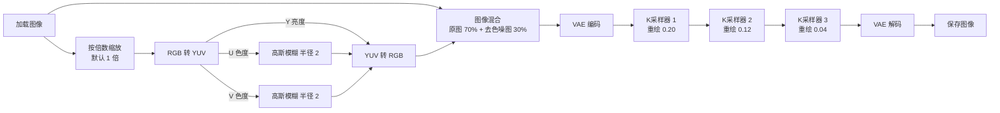

# 人像精修（Z-Image Turbo 低重绘三连采样）

把一张人像照片「原样」重绘一遍：构图、人物、颜色都不变，只把皮肤、头发、面料等细节补得更清晰干净。

- 工作流文件：[`portrait_refine_003.json`](portrait_refine_003.json)（原版，未改动）
- 租机一键安装：[`install.sh`](install.sh)

## 流程



1. **预处理（去色噪）**：把原图拆成亮度 Y 和色度 U、V，只对色度做轻微模糊再合回去，相当于去掉彩色噪点但不损失明暗细节；再以 30% 的比例混回原图。
2. **三轮低重绘**：同一个 Z-Image Turbo 模型连续采样三次，重绘幅度逐轮降低（0.20 → 0.12 → 0.04），第一轮补细节，后两轮收敛、去瑕疵。
3. **提示词**只描述「保持原样」，不描述画面内容，所以换图不用改提示词。

## 关键参数

| 节点 | 参数 |
|---|---|
| K采样器 1 | 6 步，CFG 3.5，euler / simple，重绘 0.20 |
| K采样器 2 | 4 步，CFG 3，dpmpp_2m / simple，重绘 0.12 |
| K采样器 3 | 3 步，CFG 2.5，euler / simple，重绘 0.04 |
| 高斯模糊（U、V 各一个） | blur_radius 2 |
| 图像混合 | mix，factor 0.3（0 = 全原图，1 = 全去色噪图） |
| 缩放倍数 | 宽、高各 ×1（想放大就改两个 `Multiply Int Float` 的倍数） |

正向提示词：

```text
preserve original image, preserve original subject, preserve original composition, preserve original colors, preserve original texture, clean image, stable details, clean transparent material, smooth reflection, clear highlights, no redesign
```

反向提示词：

```text
changed face, changed texture, changed pattern, changed colors, blurry edges, repainting, redesign, style change, extra details, artifacts
```

## 需要的模型（合计约 20.7GB）

都来自 [Comfy-Org/z_image_turbo](https://huggingface.co/Comfy-Org/z_image_turbo/tree/main/split_files)：

| 放到 `models/` 下的位置 | 原始文件 | 大小 |
|---|---|---|
| `diffusion_models/z_image_turbo_bf16.safetensors` | 同名 | 12.31GB |
| `text_encoders/qwen_3_4b.safetensors` | 同名 | 8.04GB |
| `vae/FLUX.1-vae.sft` | `vae/ae.safetensors`（工作流里用的是这个名字，下载后改名即可） | 0.34GB |

## 需要的插件

| 插件 | 用到的节点 |
|---|---|
| [ComfyUI_essentials](https://github.com/cubiq/ComfyUI_essentials) | `GetImageSize+`、`ImageResize+` |
| [ComfyUI_JPS-Nodes](https://github.com/JPS-GER/ComfyUI_JPS-Nodes) | `Multiply Int Float (JPS)` |
| [comfy-plasma](https://github.com/Jordach/comfy-plasma) | `JDC_GaussianBlur` |
| [comfyui-various](https://github.com/jamesWalker55/comfyui-various) | `JWImageMix` |

`ImageRGBToYUV`、`ImageYUVToRGB` 是 ComfyUI 自带节点，不用装。

## 怎么用

**在线平台（最省事）**：RunningHub、LiblibAI 等在线 ComfyUI，把 `portrait_refine_003.json` 拖进画布，缺的插件和模型按上面两张表补齐，换上自己的图点运行。

**租 GPU 机器（AutoDL 等）**：选带 ComfyUI 的镜像，开机后在终端运行：

```bash
curl -fsSL https://raw.githubusercontent.com/tianfeng66/comfyui-workflows/main/portrait-refine/install.sh | bash
```

脚本会自动找 ComfyUI 目录、装 4 个插件、下 3 个模型（Hugging Face 连不上会自动换 hf-mirror 镜像），可重复运行、断点续传。装完重启 ComfyUI，再把 json 拖进去。找不到目录时手动指定：`bash install.sh /你的/ComfyUI路径`。

建议显存 16GB 以上（如 4090 24GB）。

## 注意事项

- 三个 K 采样器的种子都是「每次随机」，同一张图每次结果会有细微差别；想固定结果就改成 `fixed`。
- 工作流里「加载CLIP」的类型是 `qwen_image`。如果运行时这一步报错，改成 `lumina2`（Z-Image 官方模板用的类型）再试。
- 已上传的工作流还没有在真机上完整跑通验证过。
